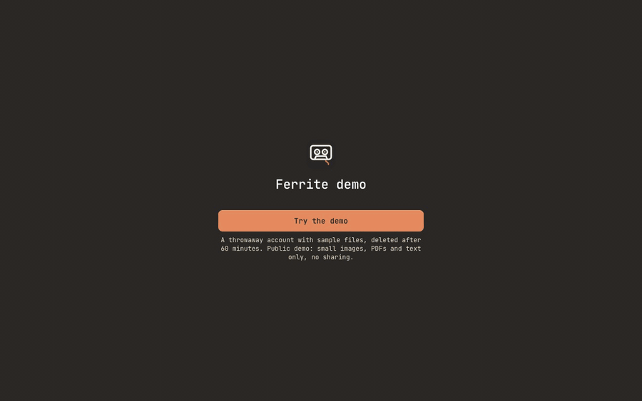
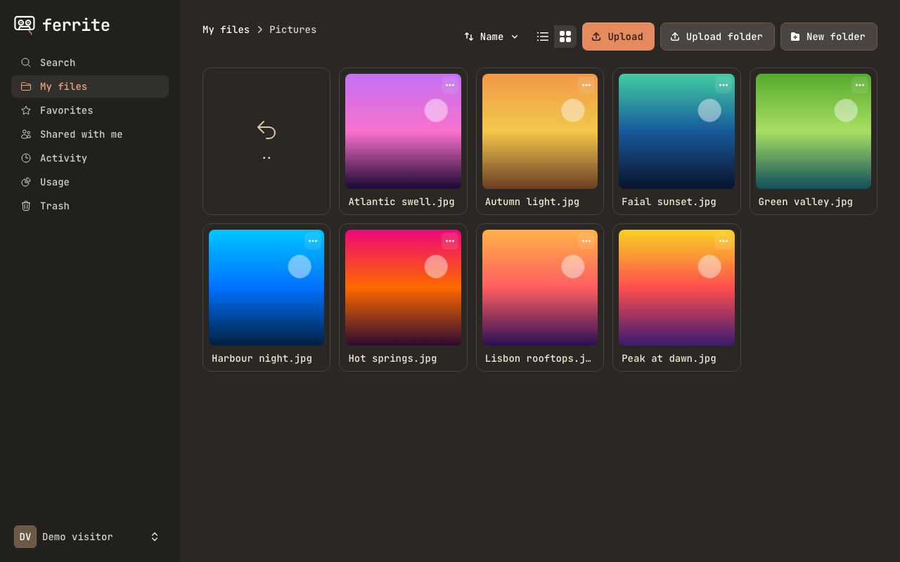
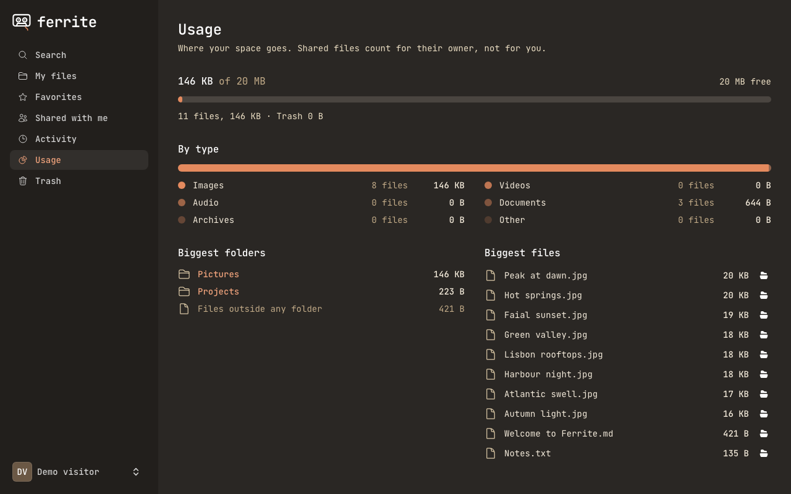
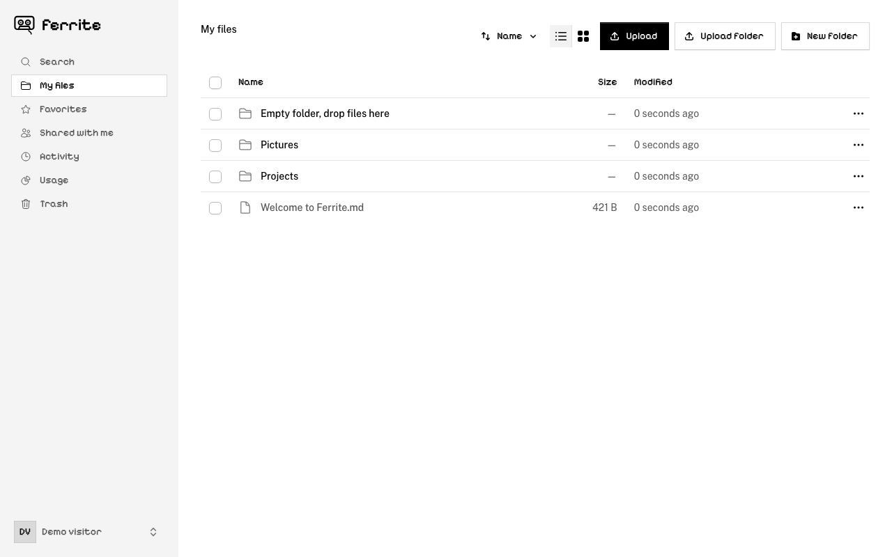
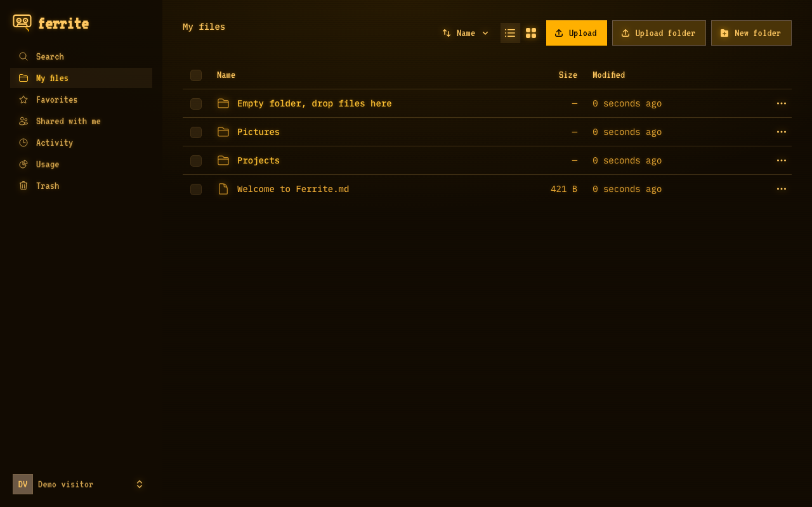
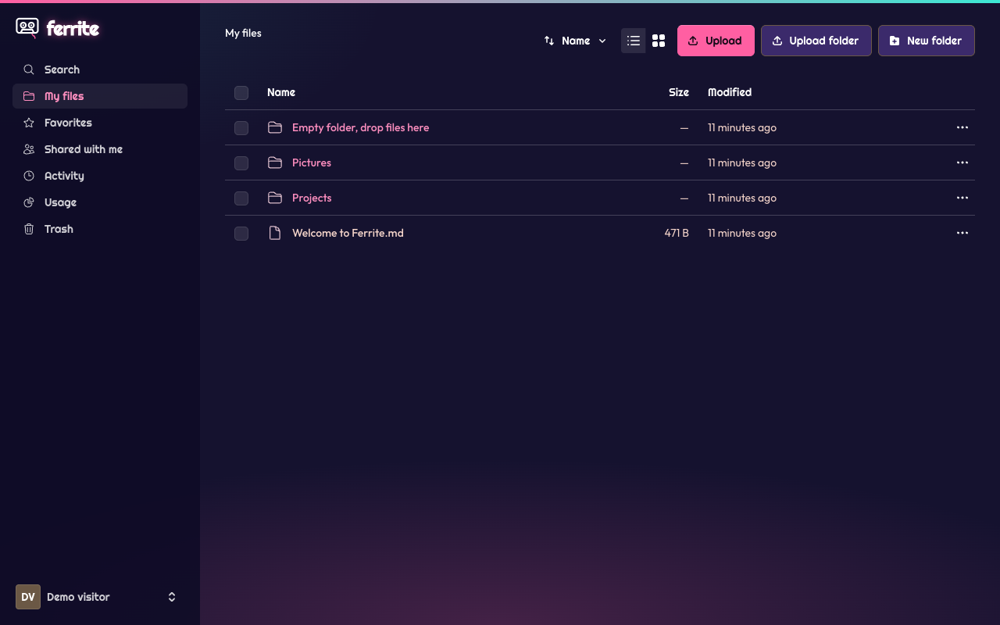
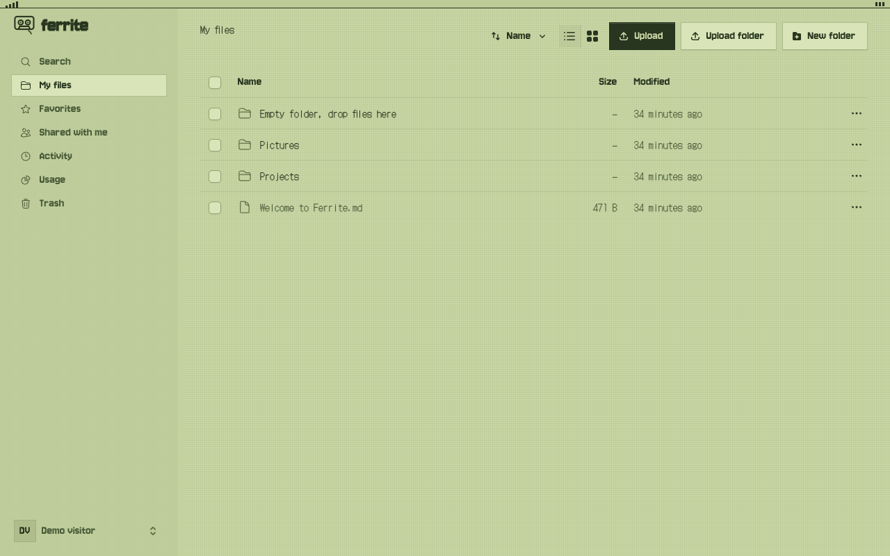

<p align="center">
  <picture>
    <source media="(prefers-color-scheme: dark)" srcset="docs/img/logo-dark.svg">
    
  </picture>
</p>

# Ferrite by StackCare

Ferrite is a self-hosted file server with a web interface. Upload, organise, preview and share files stored on a local disk, S3-compatible storage or an SFTP server. It is for individuals and small teams, and has an HTTP API for other applications. Built with Laravel, Livewire and Flux.

Not to be confused with other projects of the same name, such as the Rust Markdown editor Ferrite and the Rust DNS filter ferrite-server. This one is a Laravel file-storage app, named after the magnetic coating on tape.

<p align="center">
  
</p>

## Features

- **Files and folders.** Upload files or whole folders from the browser. Chunked uploads resume after a dropped connection, including multi-gigabyte files. Rename, move and copy. Download with Range support, and download files, a folder or a selection as a ZIP. Tick several items to move or trash them in one step. Uploading a name that already exists asks whether to replace it, keep both, skip it or cancel.
- **Previews and search.** Images (with thumbnails), PDFs, video, audio and text open in the browser. Search matches file names and the text inside text files, Markdown, code, CSV and PDFs, on SQLite, MySQL and MariaDB.
- **Sharing.** Share with other users as viewer or editor, or by link with an optional password and expiry. An upload link lets someone add files to one folder without seeing what is in it.
- **Storage.** A local folder, S3-compatible storage or SFTP. New uploads go to the default disk, or to a disk an administrator assigns to a user. Identical files are stored once. A disk can store its files encrypted with XChaCha20-Poly1305 ([docs/encryption.md](docs/encryption.md)). Names, sizes and the database are not encrypted.
- **Usage.** Space is broken down by file type, folder and file, trash and versions, with the amount deduplication saves.
- **Users and access.** Accounts with quotas, an admin screen, two-factor authentication and passkeys. An activity log records file operations.
- **Trash and versions.** Deleted files go to the trash and can be restored, and are purged after a set time. Replacing a file keeps the earlier content, which can be restored from the web app.
- **API and apps.** A token API for scripts ([docs/api.md](docs/api.md)), and apps for Mac and Android that use it ([docs/apps.md](docs/apps.md)). The apps upload and browse; they do not synchronise folders.
- **Themes.** Fifteen themes, selected per user.

Not included: sync clients, WebDAV, office document previews, real-time collaboration and OCR for scanned documents.

Project page: https://ferrite.stackcare.pt · Docs: https://ferrite.stackcare.pt/docs · Apps: https://ferrite.stackcare.pt/download · Live demo: https://demo.ferrite.stackcare.pt

## Screenshots

| | |
| --- | --- |
|  |  |
| The file browser in grid view. | The usage page: where your space goes. |
|  |  |
| Classic Mac, one of fifteen themes. | Amber terminal. |
|  |  |
| Miami Vice. | Nokia 3310. |

Try it without installing anything: https://demo.ferrite.stackcare.pt

## Install

Ferrite runs with Docker or as a regular Laravel application. Both give you the same app.

| | Docker | Laravel (without Docker) |
| --- | --- | --- |
| Best when | you want the quickest start, or the server is otherwise empty | the server already runs PHP and nginx or Apache |
| You need | Docker and Docker Compose | PHP 8.3+ (8.5 recommended), Composer, Node 20+ to build the assets, a web server, systemd or Supervisor and cron |
| Workers, scheduler, migrations | included, start with the container | you set them up (below) |

Either way you need a domain name and HTTPS in front of it. The full guide ([docs/install.md](docs/install.md)) covers reverse proxy examples, configuration, large files, backups and upgrades.

### Option 1: Docker

You need a server with Docker and a domain name pointing at it.

```sh
git clone https://github.com/zhoorta/ferrite.git && cd ferrite
cp docker/ferrite.env.example ferrite.env
docker compose run --rm ferrite php artisan key:generate --show   # copy the output into APP_KEY in ferrite.env
$EDITOR ferrite.env                                               # set APP_KEY and APP_URL at least
docker compose up -d
```

This pulls the prebuilt image (`ghcr.io/zhoorta/ferrite`, amd64 and arm64). To build from your checkout instead, use `docker compose up -d --build`. The container creates the database, runs the migrations and starts the scheduler and both queue workers.

Put a reverse proxy with HTTPS in front of port 8080 ([examples](docs/install.md#reverse-proxy)) and open your `APP_URL`. Everything that changes lives in one volume, `/data`: back it up, and keep `APP_KEY` safe.

To create the first account from the shell instead of the Welcome page:

```sh
docker compose exec ferrite php artisan ferrite:user you@example.com --admin
```

### Option 2: Laravel (without Docker)

Tested on Ubuntu 24.04 with nginx and PHP 8.5-FPM. PHP needs `gd`, `exif`, `zip`, `intl`, `bcmath`, `mbstring`, `xml`, `curl` and `pdo_sqlite` (or `pdo_mysql`). Install `poppler-utils` too if you want search inside PDFs.

```sh
git clone https://github.com/zhoorta/ferrite.git /var/www/ferrite && cd /var/www/ferrite
composer install --no-dev --optimize-autoloader
npm ci && npm run build                        # or build elsewhere and copy public/build
cp .env.example .env && php artisan key:generate
$EDITOR .env                                   # APP_ENV=production, APP_DEBUG=false, APP_URL=https://files.example.com
php artisan migrate --force
sudo chown -R www-data:www-data storage bootstrap/cache database
php artisan optimize
```

Then three things, all required. The guide has the full nginx config ([step 3](docs/install.md#3-web-server)) and the systemd units and cron entry ([step 4](docs/install.md#4-queue-workers-and-scheduler)):

1. **Web server** with `public/` as the document root.
2. **Two queue workers**, as systemd units or Supervisor programs. Without the first, uploads stay at "Storing the file…":
   ```sh
   php artisan queue:work uploads --queue=uploads --tries=1 --timeout=0 --sleep=1 --max-time=3600
   php artisan queue:work --queue=default,search --tries=3 --sleep=3 --max-time=3600
   ```
3. **The scheduler**, from cron: `* * * * * cd /var/www/ferrite && php artisan schedule:run >> /dev/null 2>&1`

Create the first account on the same address, or with `php artisan ferrite:user you@example.com --admin`. Back up `database/database.sqlite`, `.env` (it holds `APP_KEY`) and the files folder.

### The first account

A fresh install shows a **Welcome** page where you create the administrator account, and registration closes afterwards. Do this right after the first start, since whoever opens the page first becomes the admin. Add everyone else under **Users**, and turn on two-factor authentication or a passkey under Settings > Security.

## Develop

Read [CONTRIBUTING.md](CONTRIBUTING.md) before opening a pull request.

```sh
composer install && npm ci
cp .env.example .env && php artisan key:generate
php artisan migrate
composer dev            # or: php artisan serve, and npm run dev
php artisan test --compact
vendor/bin/pint && vendor/bin/phpstan analyse
```

`PLAN.md` has the scope and status, and `docs/` has the design notes:

| | |
| --- | --- |
| [docs/install.md](docs/install.md) | Install (Docker or standard Laravel), configuration, reverse proxy, backup, upgrade |
| [docs/content-search.md](docs/content-search.md) | Search inside files: what is indexed, SQLite and MySQL |
| [docs/themes.md](docs/themes.md) | The themes and how to add one |
| [docs/uploads.md](docs/uploads.md) | The chunked upload protocol |
| [docs/serving-files.md](docs/serving-files.md) | How files are served safely |
| [docs/sharing.md](docs/sharing.md) | Sharing with users and links |
| [docs/storage-search-activity.md](docs/storage-search-activity.md) | Disks, search, activity log |
| [docs/users.md](docs/users.md) | Accounts, registration, trash |
| [docs/security.md](docs/security.md) | Security review: what was checked, known limits |
| [docs/public-site.md](docs/public-site.md) | Project page, docs, app downloads and demo mode (how ferrite.stackcare.pt runs) |
| [docs/apps.md](docs/apps.md) | The Mac and Android apps: connecting, features, publishing the downloads |
| [docs/api.md](docs/api.md) | The token API |
| [docs/versions.md](docs/versions.md) | Versions of replaced files |

## Security

Ferrite serves files uploaded by users from its own origin, so read [docs/security.md](docs/security.md) before exposing an instance to people you do not trust. Report vulnerabilities privately (see [SECURITY.md](SECURITY.md)) rather than in a public issue.

## Licence

Ferrite is free software under the [GNU Affero General Public License v3.0](LICENSE) or later. If you run a modified version as a service for others, you must offer them its source.
